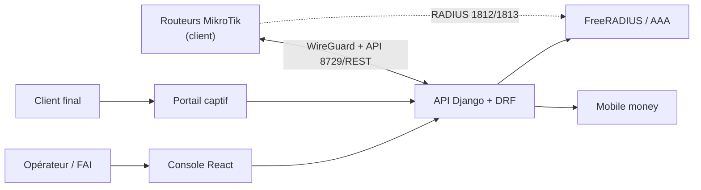

# MIKROTIKSASS

**SaaS de gestion de parc MikroTik** — hotspot Wi-Fi payant, abonnés PPPoE, caisse, paiements
mobile money, supervision — construit avec **Django** + **React**.

> **État du projet : conception.** Aucune ligne de code produit n'a encore été écrite.
> Ce dépôt contient aujourd'hui le **dossier de conception complet** : vision produit, architecture,
> intégration RouterOS, modèle de données, contrat d'API, frontend, sécurité, infrastructure,
> feuille de route et décisions d'architecture.

---

## Le produit en une phrase

> « Gérez vos routeurs MikroTik, vos abonnés et vos encaissements depuis un navigateur,
> sans WinBox, sans Excel et sans être sur place. »

Trois briques :

1. **Plan de contrôle** (notre SaaS) : configurer les routeurs, gérer forfaits, vouchers, abonnés,
   factures — via l'API RouterOS, à travers un tunnel WireGuard que le routeur initie.
2. **Plan AAA** : FreeRADIUS authentifie les clients et remonte la consommation en temps réel ;
   le routeur reste autonome (utilisateurs locaux) si la plateforme tombe.
3. **Plan utilisateur** : le trafic Internet des clients finaux ne traverse **jamais** notre plateforme
   (ni proxy, ni filtrage, ni coût de bande passante).



---

## Ordre de lecture recommandé

| # | Document | Ce que vous y trouvez | Temps |
|---|---|---|---|
| 0 | [**Vision et produit**](docs/00-vision-et-produit.md) | Les 4 produits possibles, le choix recommandé, personas, périmètre MVP, prix, concurrence | 20 min |
| 1 | [**Architecture**](docs/01-architecture.md) | Diagrammes, composants, stack, flux détaillés, multi-tenant, exigences non fonctionnelles | 25 min |
| 2 | [**Intégration MikroTik**](docs/02-integration-mikrotik.md) | Protocole API, scripts routeur, RADIUS, pièges, compatibilité, sécurité, plan de validation | 35 min |
| 3 | [**Modèle de données**](docs/03-modele-donnees.md) | ERD, tables, index, rétention, chiffrement, tables RADIUS | 25 min |
| 4 | [**Contrat d'API**](docs/04-contrat-api.md) | Conventions REST, endpoints, erreurs, webhooks, temps réel | 20 min |
| 5 | [**Frontend React**](docs/05-frontend-react.md) | Stack, routes, état, temps réel, UX des parcours, performance 3G, tests | 15 min |
| 6 | [**Sécurité et exploitation**](docs/06-securite-exploitation.md) | Risques, contrôles, données personnelles, sauvegardes, runbooks | 20 min |
| 7 | [**Infrastructure**](docs/07-infrastructure-devops.md) | Environnements, arborescence, dev local avec CHR, prod, CI/CD, coûts | 20 min |
| 8 | [**Feuille de route**](docs/08-roadmap-budget.md) | Phases, backlog, budget en FCFA, mise sur le marché, risques | 15 min |
| 9 | [**Décisions d'architecture (ADR)**](docs/09-adr/) | 6 décisions argumentées (monolithe, REST/binaire, multi-tenant, RADIUS, WireGuard, SPA) | 15 min |
| 10 | [**Checklists**](docs/10-checklists.md) | Ce qu'il faut faire **avant** de coder, décisions ouvertes, durcissement, go-live | 15 min |
| 11 | [**Glossaire**](docs/11-glossaire.md) | Vocabulaire partagé réseau / RADIUS / produit | 10 min |

**Si vous ne lisez qu'un document** : `docs/00-vision-et-produit.md` (le quoi et le pourquoi),
puis `docs/10-checklists.md` (les 40 actions concrètes avant la première ligne de code).

---

## Stack retenue

| Couche | Choix |
|---|---|
| Backend | Django 5.2 LTS + Django REST Framework, Celery, Channels |
| Base | PostgreSQL 16 + TimescaleDB, Redis 7 |
| AAA | FreeRADIUS 3.2 (module Python vers notre base) |
| Routeurs | `librouteros` (API binaire) + `httpx` (REST), derrière une interface unique |
| Frontend | React 19 + TypeScript + Vite, TanStack Query, Tailwind + shadcn/ui |
| Exécution | Docker Compose sur un VPS, Traefik, GitHub Actions |
| Paiement | Agrégateur mobile money (Orange Money, Moov, Wave, Coris) |

---

## Arborescence cible (après la phase de code)

```
backend/     API Django, workers Celery, connecteur MikroTik
frontend/    console React + portail captif + packages partagés
infra/       docker-compose, Traefik, FreeRADIUS, scripts RouterOS
docs/        cette documentation
```

Détail dans [`docs/07-infrastructure-devops.md`](docs/07-infrastructure-devops.md) §2.

---

## Prochaines étapes immédiates (2 à 4 semaines)

1. **Valider le besoin** : 10 entretiens clients (cybercafés, hôtels, petits FAI, installateurs).
2. **Valider la technique** : monter 3 CHR + FreeRADIUS, tester `listen`, WireGuard derrière NAT,
   et **surtout** le comportement quand RADIUS est arrêté
   (voir [`docs/02-integration-mikrotik.md`](docs/02-integration-mikrotik.md) §11).
3. **Trancher les 10 décisions** listées dans [`docs/10-checklists.md`](docs/10-checklists.md) §2.
4. **Ouvrir le compte de paiement** (délai de validation 4 à 8 semaines : à lancer tout de suite).
5. **Maquetter** les 10 écrans clés et les faire tester à un vrai caissier.
6. Alors seulement : **Phase 1 — socle** (multi-tenant, auth, parc réseau, enrôlement).

---

## Avertissements

- Les prix, coûts et volumes indiqués sont des **hypothèses de travail**, pas des engagements.
- Les aspects juridiques (protection des données, régulation télécom, fiscalité) doivent être
  **validés par un professionnel local** ; les documents de ce dépôt ne constituent pas un avis juridique.
- Aucun engagement de SLA ne doit être pris avant validation du comportement de repli RADIUS.

---

## Licence

À définir avant l'ouverture du dépôt (recommandation : propriétaire, tous droits réservés).
