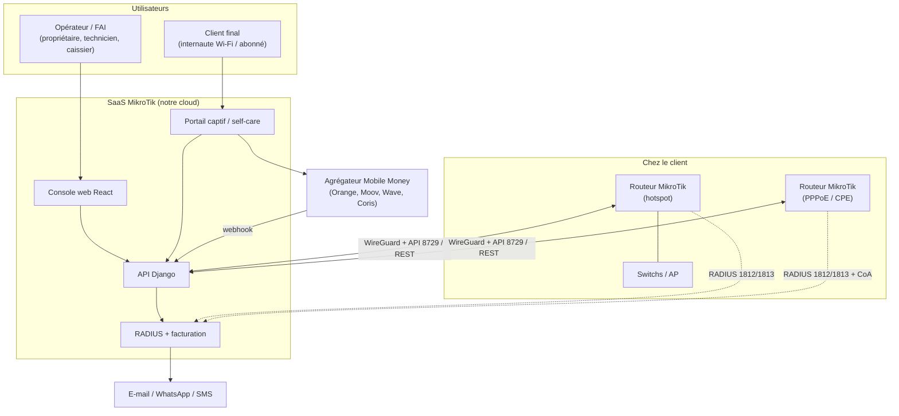
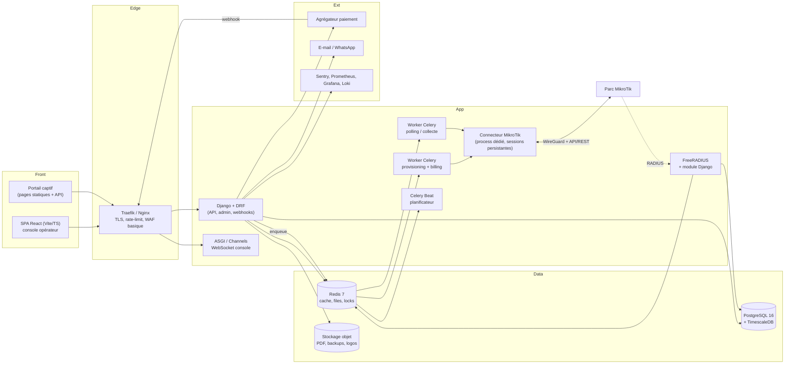
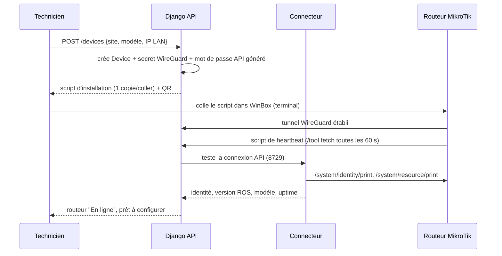
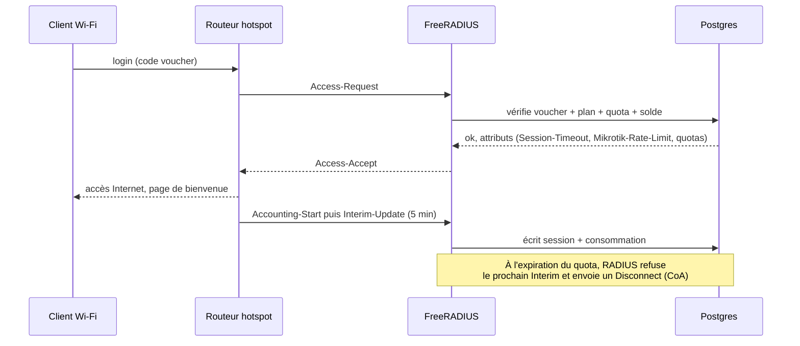
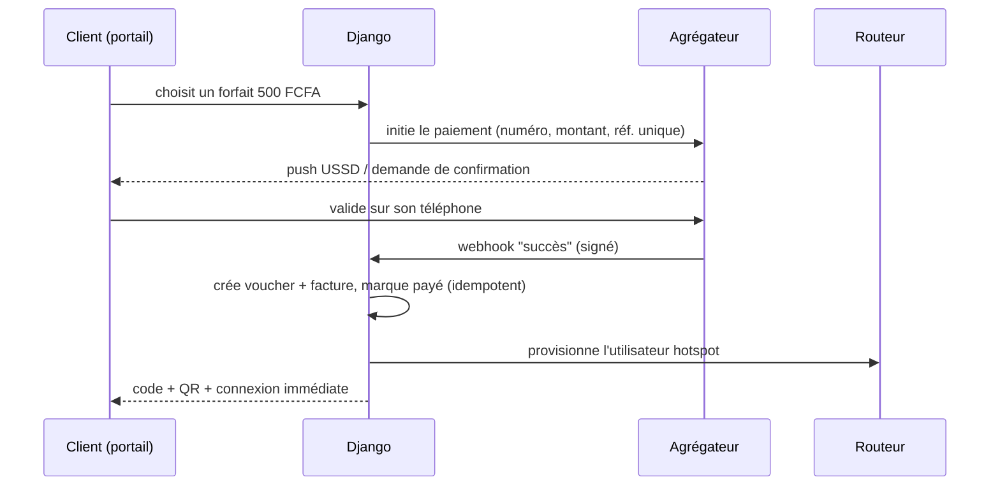

# 01 — Architecture système

> Statut : **proposition d'architecture** · Dernière mise à jour : 2026-11-01

---

## 1. Principes directeurs

| # | Principe | Conséquence concrète |
|---|---|---|
| P1 | **Séparer contrôle / AAA / données** | Le trafic des clients finaux ne traverse jamais la plateforme. On ne route que de la configuration et de la comptabilité. |
| P2 | **Le routeur se connecte à nous** | Tunnel WireGuard sortant → fonctionne derrière CGNAT/double NAT, pas d'ouverture de port chez le client. |
| P3 | **Modulaire, pas microservices** | Un monolithe Django bien découpé + workers. Les microservices seulement si un vrai besoin de charge apparaît. |
| P4 | **Tout passe par un adaptateur MikroTik** | Aucun appel `librouteros`/HTTP dispersé dans le code. Un seul composant sait parler à RouterOS. |
| P5 | **Multi-tenant partagé** | Une base, un schéma, `tenant_id` sur chaque table, isolation vérifiée par tests + RLS Postgres. |
| P6 | **Idempotence et reprise** | Chaque action vers un routeur est une `ProvisioningTask` rejouable, avec état et tentatives. |
| P7 | **Le routeur doit survivre à notre panne** | Les utilisateurs hotspot existent aussi en local sur le routeur ; RADIUS a un mode dégradé. |
| P8 | **Sécurité par défaut** | Secrets chiffrés, moindre privilège, audit inaltérable, rien de sensible dans les logs. |

---

## 2. Vue de contexte (C4 niveau 1)



**Ce qui ne passe pas par nous** : le trafic HTTP des clients finaux. Nous ne sommes ni proxy, ni
fournisseur d'accès. Cela réduit drastiquement nos coûts, notre exposition légale et nos risques de panne.

---

## 3. Vue des conteneurs (C4 niveau 2)



### Rôle du « Connecteur MikroTik »

C'est le composant le plus critique et le plus souvent mal fait. Il est **le seul** à ouvrir des
sessions vers les routeurs.

- pool de connexions par routeur (1 session de commandes + N sessions `listen`) ;
- **file sérialisée par routeur** (un routeur ne supporte pas 20 commandes concurrentes) ;
- limiteur de débit par routeur (token bucket Redis) et par tenant ;
- circuit breaker : 3 échecs → routeur marqué `UNREACHABLE`, backoff exponentiel ;
- réconciliation périodique (« desired state » vs « actual state ») ;
- tout appel est tracé (durée, taille, succès) pour le support.

---

## 4. Stack technique proposée

| Couche | Choix | Version cible | Justification |
|---|---|---|---|
| Backend | **Django + Django REST Framework** | Django 5.2 LTS, DRF 3.15+ | Batteries incluses (auth, admin, ORM, migrations), écosystème mature, facile à recruter |
| Tâches asynchrones | **Celery** + Redis | Celery 5.5 | Standard ; files dédiées par priorité |
| Temps réel console | **Django Channels** (ASGI) ou SSE | Channels 4 | Sessions actives qui se rafraîchissent sans polling |
| Base | **PostgreSQL** + **TimescaleDB** | PG 16, Timescale 2.x | Relationnel sérieux + séries temporelles (trafic, sessions) dans le même moteur |
| Cache / files / locks | **Redis** | 7.x | Cache, broker Celery, verrous distribués, rate limiting |
| AAA | **FreeRADIUS 3.2** + module Python | 3.2.x | Bien plus scalable que l'API pour l'auth hotspot/PPPoE ; support CoA |
| Client RouterOS | `librouteros` (binaire) + `httpx` (REST) | dernières | Deux backends derrière une même interface |
| Frontend | **React 19 + TypeScript + Vite** | React 19 | Rapide, écosystème immense, build léger (important en connexion faible) |
| Data fetching | **TanStack Query v5** | 5.x | Cache, retry, invalidation, états de chargement — évite Redux |
| UI | **Tailwind CSS 4 + shadcn/ui + Radix** | dernières | Composants accessibles, thème par tenant, pas de lock-in |
| Formulaires | React Hook Form + Zod | — | Validation partagée avec les schémas d'API |
| Graphiques | Recharts ou uPlot | — | uPlot pour les séries temporelles volumineuses |
| PDF | WeasyPrint (serveur) | — | Vouchers imprimables, factures, reçus |
| Conteneurisation | Docker + Docker Compose (dev) | — | Reproductibilité |
| Reverse proxy | Traefik v3 ou Nginx | — | TLS automatique, routage par host (portails par tenant) |
| CI/CD | GitHub Actions | — | Lint, tests, build, migrations, déploiement |
| Observabilité | Sentry + Prometheus/Grafana + Loki | — | Erreurs, métriques, logs centralisés |
| Lab routeur | **RouterOS CHR** (VM/Docker, licence gratuite ≤ 1 Gbit/s) | 7.x | Tester sans matériel, plusieurs versions en parallèle |

> **Choix assumé** : pas de microservices, pas de Kubernetes au démarrage. Une seule application
> Django déployée en 4 processus (web, worker-provisioning, worker-collecte, connecteur) suffit
> largement jusqu'à plusieurs centaines de sites.

---

## 5. Découpage du backend en applications Django

```
backend/
  config/                 # settings par environnement, urls, asgi/wsgi, celery
  apps/
    core/                 # modèles abstraits (TimeStamped, TenantAware), permissions, pagination, exceptions
    accounts/             # User custom, profils, rôles, invitations, 2FA, sessions
    tenants/              # Tenant, abonnements SaaS, quotas, domaine personnalisé, thème
    network/              # Site, Device, Interface, credentials chiffrés, statut, versions
    mikrotik/             # CONNECTEUR : gateway, backends (binary/rest), normalisation, tasks
    provisioning/         # ProvisioningTask, desired state, réconciliation, plans de config
    catalog/              # Plan (forfait), Profile (hotspot/ppp), règles de quota, tarifs
    subscribers/          # Client final, abonnement, adresse, pièce d'identité, historique
    vouchers/             # Lot, code, QR, impression, import CSV, statut
    aaa/                  # intégration RADIUS (radcheck/radreply/radacct), sessions, CoA
    billing/              # Facture, ligne, prorata, paiement, relance, avoir
    payments/             # agrégateurs mobile money, webhooks, réconciliation
    portal/               # portail captif : templates par tenant, parcours d'achat
    monitoring/           # métriques, alertes, règles, incidents, heartbeat
    notifications/        # e-mail, WhatsApp, SMS, templates, préférences
    audit/                # journal d'audit immuable, diff de configuration
    api/                  # routage DRF v1, schémas OpenAPI, webhooks sortants
```

Règles de dépendance : `api → apps`, `apps → core`, **jamais** l'inverse ; `mikrotik` ne connaît ni
`billing` ni `portal` (il reçoit des ordres neutres).

---

## 6. Flux clés

### 6.1 Onboarding d'un routeur



Le script d'installation doit être **idempotent** et ne jamais casser la configuration existante :
il crée une interface WireGuard, un utilisateur API dédié, un groupe restreint, et un scheduler de heartbeat.

### 6.2 Connexion d'un client hotspot (voie RADIUS)



### 6.3 Achat d'un voucher par mobile money



### 6.4 Coupure pour impayé (abonnés PPPoE)

`Celery Beat` (toutes les heures) → sélectionne les abonnements échus → tâche `SuspendSubscription` →
met à jour `radcheck` (rejet) **et** désactive le secret PPP / ajoute l'adresse à une `address-list`
`SUSPENDED` → envoie un Disconnect CoA pour couper la session en cours → notifie le client.

---

## 7. Multi-tenant

**Stratégie retenue : schéma partagé, `tenant_id` obligatoire.**

| Option | Avantages | Inconvénients | Verdict |
|---|---|---|---|
| Schéma par tenant (`django-tenants`) | Isolation forte, restauration par tenant | Migrations × N, requêtes transverses difficiles, connexions DB nombreuses | Rejeté pour le MVP |
| Base par tenant | Isolation maximale | Explosion opérationnelle | Rejeté |
| **Schéma partagé + RLS** | Simple, requêtes de flotte globales, une migration | Risque de fuite si on oublie un filtre | **Retenu** |

Garde-fous :
- `TenantAwareModel` + manager qui lève une exception si `tenant_id` n'est pas défini ;
- middleware qui fixe `request.tenant` (JWT → `tenant_id` → header `X-Tenant` validé) ;
- **Row Level Security** Postgres en défense en profondeur (`SET LOCAL app.tenant_id`);
- tests automatisés : pour chaque endpoint, un test « le tenant A ne voit pas les données du B » ;
- pas de `pk` seul dans les URLs : toujours `/tenants/{slug}/…` implicite côté serveur.

---

## 8. Exigences non fonctionnelles

| Domaine | Exigence | Vérification |
|---|---|---|
| Disponibilité console | 99,5 %/mois (≈ 3 h 39 d'indisponibilité) | Monitoring externe + page de statut publique |
| Disponibilité AAA | 99,9 % — une panne RADIUS coupe les clients | Redondance, cache local, healthchecks |
| Latence API | p95 < 300 ms (hors appels routeur) | Mesure Prometheus |
| Commande routeur | p95 < 2 s ; timeout 10 s ; 3 tentatives | Traces par tâche |
| Sauvegarde | RPO 15 min, RTO 2 h | Test de restauration mensuel |
| Charge cible an 1 | 150 tenants, 600 routeurs, 20 000 clients actifs, 5 M lignes de comptabilité/mois | Test de charge k6 |
| Sécurité | OWASP ASVS niveau 2, dépendances scannées, secrets hors du code | CI + revue trimestrielle |
| i18n | FR par défaut, EN prévu ; FCFA/XOF, fuseau GMT | Chaînes externalisées dès le J1 |
| Accessibilité / mobile | Console utilisable sur tablette et en 3G | Budget perf Lighthouse |

---

## 9. Environnements

| Env | Rôle | Contenu | Accès |
|---|---|---|---|
| `local` | Développement | Docker Compose, 3 CHR (7.15, 7.18, 6.49) | Dev |
| `staging` | Recette, démos clients | 1 CHR + 1 routeur physique de test | Équipe |
| `prod` | Clients | VPS dédié, sauvegardes chiffrées | Restreint, bastion |

Un **labo routeur permanent** est obligatoire : au minimum un CHR par version majeure supportée, plus
un vrai routeur (ex. hAP ac², RB4011) pour valider les cas réels (CPU faible, flash limitée).

---

## 10. Ce qu'on ne fait pas (et pourquoi)

- **Pas de microservices** : coût d'exploitation élevé, équipe petite, domaine fortement couplé.
- **Pas de Kubernetes** au départ : un VPS + Docker Compose + sauvegardes suffit ; on migrera si besoin.
- **Pas de GraphQL** : l'API REST versionnée couvre 95 % des besoins et reste simple à documenter.
- **Pas de stockage des mots de passe routeur en clair**, jamais, nulle part, même en debug.
- **Pas de polling agressif** : sur un hAP lite, interroger toutes les 5 s dégrade le service des clients.
- **Pas de dépendance à une seule version de RouterOS** : la couche `mikrotik` normalise les différences.
