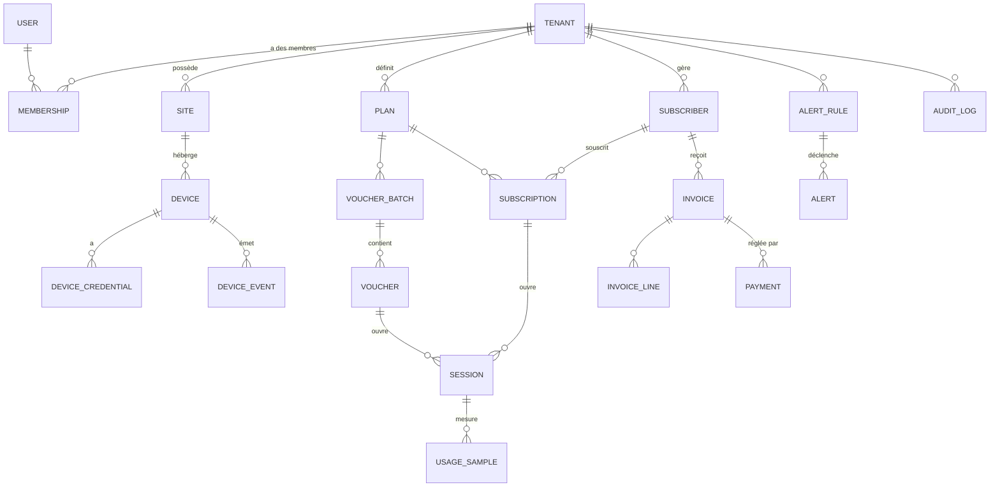

# 03 — Modèle de données

> Statut : **spécification** · Dernière mise à jour : 2026-11-01
> Cible : PostgreSQL 16 + TimescaleDB. Toutes les tables métier portent `tenant_id`.

---

## 1. Conventions

| Règle | Détail |
|---|---|
| Clés primaires | `UUID v7` (triable par le temps, non devinable) sauf tables volumineuses en `bigint` |
| Multi-tenant | `tenant_id UUID NOT NULL` + index composite `(tenant_id, …)` en tête |
| Horodatage | `created_at`, `updated_at` en `timestamptz` (UTC) ; affichage en `Africa/Ouagadougou` |
| Suppression | `deleted_at` (soft delete) sur les entités métier ; purge réelle planifiée |
| Argent | `bigint` en **FCFA entier** (XOF n'a pas de décimales) ; jamais de `float` |
| Données techniques | octets en `bigint`, durées en secondes, débits en kbit/s |
| Secrets | colonne `bytea` chiffrée + `key_version` |
| Nommage | tables `snake_case` au pluriel, FK suffixées `_id`, contraintes explicites |
| Énumérations | `text` + `CHECK` (plus simple à faire évoluer que les types PG) |

---

## 2. Vue d'ensemble (ERD simplifié)

Le détail table par table suit. Les tables RADIUS (`radcheck`, `radreply`, `radacct`, …) sont
décrites en §7 : elles respectent le schéma standard FreeRADIUS.

---

## 3. Identité, tenants, habilitations

### `tenants`
| Colonne | Type | Notes |
|---|---|---|
| `id` | uuid PK | |
| `slug` | citext UNIQUE | utilisé dans les URLs et sous-domaines |
| `name` | text | nom commercial |
| `legal_name`, `tax_id`, `phone`, `email`, `address` | text | facturation |
| `country` | char(2) | défaut `BF` |
| `currency` | char(3) | défaut `XOF` |
| `timezone` | text | défaut `Africa/Ouagadougou` |
| `status` | text | `trial`, `active`, `suspended`, `closed` |
| `plan_code` | text | offre SaaS (Starter/Pro/Business) |
| `trial_ends_at` | timestamptz | |
| `branding` | jsonb | logo, couleurs, domaine personnalisé |
| `settings` | jsonb | polling, quotas, options |
| `created_at`, `updated_at`, `deleted_at` | timestamptz | |

### `users`
Utilisateur Django personnalisé (`AUTH_USER_MODEL`), **sans** `tenant_id` : un humain peut
appartenir à plusieurs tenants (technicien externalisé).

| Colonne | Type | Notes |
|---|---|---|
| `id` | uuid PK | |
| `email` | citext UNIQUE | identifiant de connexion |
| `password` | text | hash Argon2 |
| `full_name`, `phone` | text | |
| `locale` | text | `fr` / `en` |
| `is_staff`, `is_superuser`, `is_active` | bool | |
| `mfa_enabled`, `mfa_secret` (chiffré) | | TOTP |
| `last_login_at`, `last_login_ip` | | |

### `memberships`
| Colonne | Type | Notes |
|---|---|---|
| `id` | uuid PK | |
| `tenant_id` | uuid FK | |
| `user_id` | uuid FK | |
| `role` | text | `owner`, `admin`, `technician`, `cashier`, `viewer` |
| `invited_by_id`, `invited_at`, `accepted_at` | | invitations |
| `is_active` | bool | |
| | | UNIQUE (`tenant_id`, `user_id`) |

### `api_tokens` (intégrations tierces)
`id`, `tenant_id`, `name`, `token_hash` (jamais en clair), `scopes` (text[]), `last_used_at`,
`expires_at`, `revoked_at`.

---

## 4. Parc réseau

### `sites`
`id`, `tenant_id`, `name`, `code`, `address`, `city`, `country`, `timezone`, `geo` (point),
`notes`, `created_at`.
Index : `(tenant_id, name)`.

### `devices`
| Colonne | Type | Notes |
|---|---|---|
| `id` | uuid PK | |
| `tenant_id`, `site_id` | uuid FK | |
| `name` | text | libellé interne |
| `serial`, `model`, `architecture` | text | remontés par l'API |
| `ros_version`, `firmware` | text | |
| `management_ip` | inet | IP dans le tunnel WireGuard |
| `public_ip` | inet | info, non utilisée pour se connecter |
| `status` | text | `pending`, `online`, `degraded`, `unreachable`, `disabled` |
| `last_seen_at`, `last_health_at` | timestamptz | |
| `health` | jsonb | CPU, RAM, température, uptime, voltage |
| `transport` | text | `rest`, `binary`, `script_pull` |
| `tls_fingerprint` | text | épinglage du certificat |
| `poll_interval_s` | int | défaut 60 |
| `enrolled_at`, `enrolled_by_id` | | |
| `config_backup_at` | timestamptz | dernière sauvegarde |
| `deleted_at` | | |

Index : `(tenant_id, status)`, `(tenant_id, site_id)`, UNIQUE `(tenant_id, serial)`.

### `device_credentials` (table séparée, accès restreint)
`id`, `tenant_id`, `device_id`, `username`, `secret_encrypted` (bytea), `key_version` (int),
`wireguard_private_key_encrypted` (bytea), `rotated_at`, `created_at`.
**Aucun accès en lecture depuis l'API publique** ; uniquement via le service `mikrotik`.

### `device_events`
`id` (bigserial), `tenant_id`, `device_id`, `type` (`online`, `offline`, `reboot`, `config_changed`,
`version_changed`, `auth_failed`, `listen_reconnected`), `payload` (jsonb), `created_at`.
Partitionnée par mois ; conservation 12 mois.

### `device_backups`
`id`, `tenant_id`, `device_id`, `kind` (`export`, `binary`), `size_bytes`, `hash`, `storage_key`,
`ros_version`, `created_at`. Déduplication par `hash` (on ne stocke que les changements).

### `interfaces`
`id`, `tenant_id`, `device_id`, `name`, `type`, `mac`, `mtu`, `running`, `disabled`,
`last_rx_bytes`, `last_tx_bytes`, `last_counter_at`. Table de travail (upsert), pas d'historique ici.

---

## 5. Offres, vouchers, abonnés

### `plans` (forfaits vendus)
| Colonne | Type | Notes |
|---|---|---|
| `id` | uuid PK | |
| `tenant_id` | uuid FK | |
| `name`, `description` | text | « 1 heure », « 24 h – 5 Mbps » |
| `kind` | text | `hotspot_voucher`, `hotspot_time`, `pppoe` |
| `price` | bigint | FCFA |
| `validity_seconds` | int | durée de vie du crédit |
| `duration_seconds` | int | durée de connexion incluse (nullable) |
| `data_limit_bytes` | bigint | quota total (nullable) |
| `rate_down_kbps`, `rate_up_kbps` | int | `Mikrotik-Rate-Limit` |
| `session_timeout_s`, `idle_timeout_s` | int | |
| `device_limit` | int | partage de compte (via `Shared-Users`) |
| `is_public` | bool | achetable en ligne |
| `is_active` | bool | |
| `router_profile_name` | text | profil hotspot/PPP correspondant |
| `sort_order` | int | |

### `voucher_batches`
`id`, `tenant_id`, `plan_id`, `device_id` (nullable = multi-sites), `prefix`, `quantity`,
`generated_by_id`, `printed_at`, `notes`, `created_at`.

### `vouchers`
| Colonne | Type | Notes |
|---|---|---|
| `id` | uuid PK | |
| `tenant_id`, `batch_id`, `plan_id` | uuid FK | |
| `code` | text | lisible, sans ambiguïté (`2345-6789`, alphabet sans I/O/0/1) |
| `password` | text | optionnel (code seul = pratique) |
| `status` | text | `unused`, `active`, `used`, `expired`, `revoked` |
| `used_at`, `expires_at` | timestamptz | |
| `bound_mac` | macaddr | verrouillage éventuel |
| `sold_price`, `sold_at`, `sold_by_id` | | caisse |
| `invoice_id` | uuid | si vendu en ligne |
| `router_object_id` | text | `.id` RouterOS pour réconciliation |
| `sync_state` | text | `pending`, `synced`, `failed`, `drift` |
| | | UNIQUE (`tenant_id`, `code`) |

Index : `(tenant_id, status)`, `(tenant_id, plan_id, status)`, `(code)` (recherche caisse).

### `subscribers` (clients finaux récurrents — PPPoE/FAI)
`id`, `tenant_id`, `code` (matricule), `full_name`, `phone` (UNIQUE par tenant), `email`,
`address`, `id_number`, `customer_type` (`individual`, `business`), `device_id`,
`ppp_username`, `ppp_password_encrypted`, `mac_address`, `static_ip`,
`status` (`active`, `suspended`, `cancelled`), `created_at`, `deleted_at`.

### `subscriptions`
`id`, `tenant_id`, `subscriber_id`, `plan_id`, `started_at`, `current_period_start`,
`current_period_end`, `billing_cycle` (`monthly`, `prepaid_day`, `prepaid_volume`),
`price_override`, `auto_suspend`, `status` (`active`, `past_due`, `suspended`, `ended`),
`cancelled_at`, `next_invoice_at`.
Index : `(tenant_id, status, current_period_end)` — sert au job de suspension.

### `sessions` (= `radacct` applicatif, vue consolidée)
| Colonne | Type | Notes |
|---|---|---|
| `id` | uuid PK | |
| `tenant_id`, `device_id` | uuid | |
| `voucher_id`, `subscription_id` | uuid nullable | l'un des deux |
| `username` | text | |
| `acct_session_id` | text | fourni par RADIUS |
| `framed_ip`, `calling_station_id` | | IP et MAC du client |
| `started_at`, `stopped_at`, `last_update_at` | timestamptz | |
| `bytes_in`, `bytes_out`, `seconds` | bigint | totaux consolidés |
| `terminate_cause` | text | `user_request`, `session_timeout`, `admin_reset`, `nas_error` |
| `quality` | jsonb | signal Wi-Fi, NAS-Port … (si disponible) |

Index : `(tenant_id, started_at DESC)`, `(tenant_id, username, started_at DESC)`,
`(device_id, stopped_at)` partiel `WHERE stopped_at IS NULL` (sessions ouvertes).

### `usage_samples` (TimescaleDB, hypertable)
`time` (timestamptz), `tenant_id`, `device_id`, `session_id`, `bytes_in`, `bytes_out`,
`rate_down_kbps`, `rate_up_kbps`.
Hypertable avec chunk de 1 jour, compression après 7 jours, rétention 13 mois (agrégats conservés).

### `traffic_samples` (TimescaleDB) — compteurs d'interface
`time`, `tenant_id`, `device_id`, `interface`, `rx_bps`, `tx_bps`. Chunk 1 jour, rétention 90 jours,
`continuous aggregate` horaire et journalière.

---

## 6. Facturation et paiements

### `invoices`
`id`, `tenant_id`, `number` (séquence par tenant), `subscriber_id` nullable, `voucher_batch_id`
nullable, `issued_at`, `due_at`, `period_start`, `period_end`, `subtotal`, `discount`, `tax`
(TVA 18 % BF si assujetti — configurable), `total`, `currency`, `status` (`draft`, `issued`, `paid`,
`partially_paid`, `void`, `overdue`), `pdf_key`, `notes`.
UNIQUE (`tenant_id`, `number`).

### `invoice_lines`
`id`, `invoice_id`, `description`, `quantity`, `unit_price`, `amount`, `plan_id`, `metadata` jsonb.

### `payments`
| Colonne | Type | Notes |
|---|---|---|
| `id` | uuid PK | |
| `tenant_id`, `invoice_id`, `subscription_id` | | |
| `provider` | text | `orange_money_bf`, `moov_money_bf`, `wave`, `coris`, `cash`, `bank`, `cinetpay` |
| `provider_ref` | text | id de transaction côté agrégateur |
| `amount` | bigint | |
| `currency` | char(3) | |
| `status` | text | `pending`, `succeeded`, `failed`, `refunded` |
| `payer_msisdn` | text | chiffré/masqué en affichage |
| `raw_payload` | jsonb | réponse complète (traçabilité) |
| `idempotency_key` | text UNIQUE | évite les doubles crédits |
| `created_at`, `settled_at` | | |

### `payment_webhook_events`
`id`, `provider`, `event_id` UNIQUE, `signature_valid` bool, `payload` jsonb, `processed_at`,
`error`. Rejoue les webhooks manquants.

### `ledger_entries` (optionnel v1.1 — comptabilité interne)
`id`, `tenant_id`, `date`, `account`, `debit`, `credit`, `ref_type`, `ref_id`, `description`.
Permet un état de trésorerie sans prétendre à une comptabilité certifiée.

### `saas_subscriptions` (ce que le tenant nous paie)
`id`, `tenant_id`, `plan_code`, `price`, `billing_cycle`, `trial_ends_at`, `current_period_end`,
`status`, `payment_provider`, `next_attempt_at`, `dunning_level` (0–4).

---

## 7. Tables RADIUS (schéma standard FreeRADIUS)

Conservées telles quelles pour compatibilité, avec `tenant_id` ajouté et indexé :

| Table | Rôle | Ajout |
|---|---|---|
| `radcheck` | attributs de vérification (`Cleartext-Password`, `Expiration`) | `tenant_id`, UNIQUE (`tenant_id`,`username`,`attribute`) |
| `radreply` | attributs de réponse | `tenant_id` |
| `radgroupcheck` / `radgroupreply` | gabarits par plan | `tenant_id`, `plan_id` |
| `radusergroup` | utilisateur → groupe | `tenant_id` |
| `radacct` | sessions et comptabilité | `tenant_id`, `device_id` |

⚠️ Les noms d'utilisateur RADIUS ne sont uniques que **par tenant**. Deux options :
1. préfixer `username` par le slug du tenant (`bf01-client01`) — simple, lisible en debug ;
2. résoudre le tenant par `NAS-IP-Address` (le routeur) — plus propre mais dépend du NAS.

→ **Recommandé : option 2 en priorité, option 1 comme filet de sécurité** (voir ADR `0005`).

---

## 8. Supervision, support, audit

- `alert_rules` : `tenant_id`, `name`, `metric`, `operator`, `threshold`, `duration_s`, `severity`,
  `channels` (text[]), `scope` (tenant/site/device), `is_active`.
- `alerts` : `tenant_id`, `rule_id`, `device_id`, `status` (`firing`, `ack`, `resolved`), `value`,
  `started_at`, `resolved_at`, `ack_by_id`.
- `tickets` : `tenant_id`, `subscriber_id`, `subject`, `description`, `priority`, `status`,
  `assignee_id`, `created_at`, `closed_at` (+ `ticket_messages`).
- `audit_logs` : `id`, `tenant_id`, `actor_id`, `actor_type` (`user`/`system`/`api_token`),
  `action` (`device.update`, `voucher.revoke`, `payment.refund`…), `object_type`, `object_id`,
  `before` jsonb, `after` jsonb, `ip`, `user_agent`, `created_at`.
  **Append-only** : `REVOKE UPDATE, DELETE` pour le rôle applicatif ; partitionné par mois.
- `notifications` : `id`, `tenant_id`, `channel`, `recipient`, `template`, `payload`, `status`,
  `provider_ref`, `sent_at`, `error`.
- `outbox` : `id`, `aggregate_type`, `aggregate_id`, `event_type`, `payload`, `published_at`
  (transactional outbox pour les webhooks sortants).

---

## 9. Index et performances

| Table | Index critiques | Raison |
|---|---|---|
| `vouchers` | `(tenant_id, status)` ; `(tenant_id, code)` | caisse et recherche |
| `sessions` | `(tenant_id, started_at DESC)` ; partiel ouvertes | écran « sessions actives » |
| `radacct` | `(acctsessionid)` ; `(username, acctstarttime)` | FreeRADIUS |
| `subscriptions` | `(tenant_id, status, current_period_end)` | job de suspension |
| `devices` | `(tenant_id, status)` ; `(last_seen_at)` | tableau de bord |
| `payments` | `(tenant_id, status)` ; UNIQUE `provider_ref` | réconciliation |
| `audit_logs` | `(tenant_id, created_at DESC)` | écran d'audit |

Règles : pas d'index « au cas où » ; tout index est justifié par une requête réelle et vérifié par
`EXPLAIN ANALYZE` sur des jeux de test réalistes (10 000 vouchers, 200 000 sessions).

---

## 10. Rétention et archivage

| Donnée | En ligne | Puis |
|---|---|---|
| `usage_samples`, `traffic_samples` | 90 j détaillés | agrégats 13 mois, export froid S3 |
| `sessions` | 13 mois | archive compressée 5 ans (obligations) |
| `radacct` | 13 mois | purge (les totaux sont déjà dans `sessions`) |
| `audit_logs` | 24 mois | archive WORM |
| `device_events` | 12 mois | purge |
| `device_backups` | 10 versions / routeur | purge des plus anciennes |
| Vouchers | vie + 13 mois | anonymisation des données client |
| Factures | 10 ans | conservation légale |

---

## 11. Chiffrement et secrets

- `device_credentials.secret_encrypted` : AES-256-GCM (ou Fernet) avec **enveloppe** :
  la clé de données (DEK) est chiffrée par une clé maître (KEK) stockée hors base (variable
  d'environnement, KMS ou Vault).
- `key_version` sur chaque secret → rotation sans réécriture totale.
- `ppp_password_encrypted`, `payment.payer_msisdn`, `mfa_secret` : même mécanisme.
- Aucun secret dans les logs, les messages d'erreur, les exports CSV ou Sentry (filtres explicites).

---

## 12. Données de référence à prévoir dès le départ

- pays + devises + fuseaux (BF en premier) ;
- opérateurs mobile money et préfixes téléphoniques (Orange 07/57, Moov 01/60/61/66, Telecel 50/51/…)
  → utiles pour déduire l'opérateur du numéro ;
- profils RouterOS par défaut (`1 Mbps`, `2 Mbps`, `5 Mbps`, `10 Mbps`, `illimité`) ;
- causes de fin de session RADIUS (`Acct-Terminate-Cause`) ;
- gabarits de notification (FR) et gabarits de portail captif.
