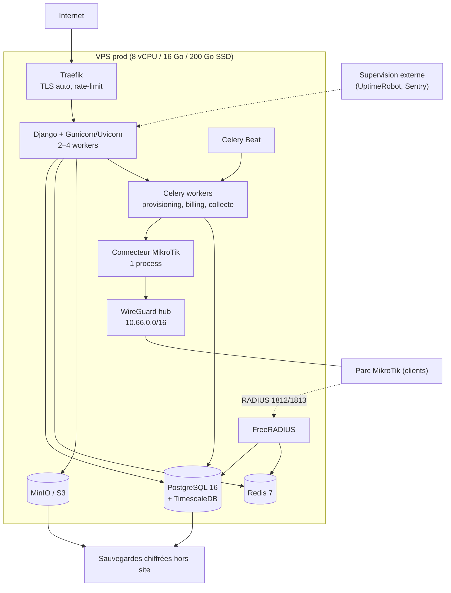

# 07 — Infrastructure, développement et déploiement

> Statut : **spécification d'exploitation** · Dernière mise à jour : 2026-11-01

---

## 1. Environnements

| Env | Usage | Hébergement | Particularités |
|---|---|---|---|
| `local` | Développement | Machine du dev (Docker Compose) | 3 CHR en conteneurs, backend factice |
| `ci` | Tests automatisés | GitHub Actions | Postgres/Redis services, aucun routeur réel |
| `staging` | Recette, démos, formations | 1 VPS 4 vCPU / 8 Go | Données anonymisées, 1 CHR + 1 vrai routeur |
| `prod` | Clients | 1 VPS dédié 8 vCPU / 16 Go (évolutif) | Sauvegardes hors site, supervision externe |

Pas de « préprod » séparée au début : `staging` suffit. On ajoute un environnement dédié quand
l'équipe dépasse 3 développeurs.

---

## 2. Arborescence du dépôt (cible)

```
MIKROTIKSASS/
├─ README.md
├─ docs/                     # CE dossier : conception, décisions, checklists
├─ backend/
│  ├─ manage.py
│  ├─ pyproject.toml
│  ├─ config/
│  │  ├─ settings/{base,local,ci,staging,prod}.py
│  │  ├─ urls.py, asgi.py, wsgi.py, celery.py
│  ├─ apps/{core,accounts,tenants,network,mikrotik,provisioning,catalog,
│  │        subscribers,vouchers,aaa,billing,payments,portal,monitoring,
│  │        notifications,audit,api}/
│  ├─ tests/                 # fixtures, factories, tests d'intégration
│  └─ Dockerfile
├─ frontend/
│  ├─ apps/console/          # React (Vite)
│  ├─ apps/portal/
│  ├─ packages/{ui,api-client,i18n,config}/
│  ├─ pnpm-workspace.yaml
│  └─ Dockerfile
├─ infra/
│  ├─ docker-compose.yml            # prod
│  ├─ docker-compose.dev.yml        # dev
│  ├─ traefik/                      # configuration proxy
│  ├─ postgres/init/                # extensions (timescaledb), rôles, RLS
│  ├─ freeradius/{clients.conf,mods-config,sites-enabled}/
│  ├─ routeros/                     # scripts .rsc (enrôlement, hardening, backup)
│  └─ scripts/                      # backup, restore, provisioning dev
├─ .github/workflows/{ci.yml,deploy.yml,security.yml}
├─ Makefile                         # make dev / make test / make deploy
└─ .env.example
```

---

## 3. Développement local

`make dev` doit, en une commande :
1. démarrer Postgres (Timescale), Redis, le backend, le worker, le frontend, FreeRADIUS ;
2. appliquer les migrations + charger des données de démonstration ;
3. démarrer **2 CHR** (7.11 et 7.18) avec des configurations de test ;
4. exposer `http://localhost:8000` (API), `http://localhost:5173` (console), `http://localhost:5174` (portail).

### CHR en local (routeur de test)

```
# Exemple de démarrage (à adapter selon l'hôte : KVM, Proxmox ou conteneur privilégié)
qemu-system-x86_64 -m 256 -smp 1 -hda chr-7.18.img \
  -netdev user,id=n1,hostfwd=tcp::8729-:8729,hostfwd=tcp::8291-:8291 -device virtio-net,netdev=n1
```

- Licence CHR gratuite (plafonnée à 1 Gbit/s) : suffisante pour le développement.
- Faire un **snapshot** de l'image avant chaque scénario destructif.
- Scripts de configuration versionnés dans `infra/routeros/` — jamais de config faite « à la main »
  puis oubliée.

### Jeu de données de démonstration

`python manage.py seed_demo` crée : 2 tenants, 6 sites, 12 routeurs (factices), 40 forfaits,
1 500 vouchers, 300 abonnés, 6 mois de sessions et factures. Objectif : toutes les pages ont l'air
« vivantes » en démo, et les tests de performance ont du volume.

---

## 4. Topologie de production (cible an 1)



### Dimensionnement indicatif

| Charge | vCPU | RAM | Disque | Remarque |
|---|---|---|---|---|
| ≤ 50 sites | 4 | 8 Go | 100 Go | tout sur un VPS |
| 50 – 200 sites | 8 | 16 Go | 250 Go | séparer Postgres sur un second VPS |
| 200 – 800 sites | 16 | 32 Go | 500 Go SSD + stockage objet | 2 nœuds web + Postgres managé |

Le facteur limitant n'est ni le CPU ni la RAM : c'est le **nombre de sessions API persistantes** et
la **latence vers les routeurs**. Prévoir 1 000 sessions persistantes par 2 Go de RAM du connecteur.

---

## 5. Réseau et nommage

| Élément | Convention |
|---|---|
| API | `api.<domaine>` |
| Console | `app.<domaine>` |
| Portail public | `pay.<domaine>` puis `<slug>.<domaine>` en marque blanche |
| Documentation | `docs.<domaine>` |
| Statut | `status.<domaine>` |
| Tunnel WireGuard | `10.66.0.0/16` — `10.66.<tenant>.<device>` |
| RADIUS | `10.66.0.1:1812/1813` côté VPN + endpoint public UDP pour les routeurs sans tunnel |
| Certificats | Let's Encrypt via Traefik ; wildcard si marque blanche |

> **Attention** : RADIUS en UDP public doit être protégé par secret par routeur, allowlist d'IP quand
> c'est possible, et surveillance des `Access-Reject` anormaux (tentatives de brute force).

---

## 6. CI/CD

### Pipeline à chaque pull request
1. `ruff format --check`, `ruff check`, `mypy` (backend) ; `eslint`, `tsc --noEmit` (frontend).
2. Tests unitaires + intégration (Postgres/Redis éphémères), couverture minimale **70 %** sur
   `apps/mikrotik`, `apps/billing`, `apps/aaa` (les zones à risque).
3. `pip-audit`, `npm audit`, `gitleaks`, `trivy` sur les images.
4. Tests de contrat OpenAPI + `openapi-typescript` (le client front doit compiler).
5. Playwright (8 scénarios) sur un build de prévisualisation.

### Pipeline de déploiement (`main` → staging → prod)
1. Build des images, tag par SHA.
2. Migrations **à blanc** (`--plan`) vérifiées, puis appliquées.
3. Déploiement progressif : `connecteur` → `workers` → `web` (le connecteur d'abord évite les
   commandes perdues).
4. Smoke tests automatiques (health, login, liste devices, RADIUS `status-server`).
5. Rollback en une commande (image précédente) ; les migrations doivent être **rétrocompatibles**
   (expand/contract).

### Règles
- Aucune modification manuelle en production (sauf incident documenté dans le post-mortem).
- Fenêtre de déploiement hors pointe (22 h – 6 h GMT) pour les changements sensibles.
- Les migrations destructrices (suppression de colonne) sont séparées d'au moins une version.

---

## 7. Sauvegardes

```
pg_dump --format=custom  →  chiffré (age/gpg)  →  S3 hors site  →  rétention 30 j
WAL archivés             →  chiffré           →  S3             →  RPO 15 min
MinIO/S3 (PDF, backups)  →  réplication       →  second bucket
```

- Test de restauration **mensuel** sur une base neuve, chronométré, avec procès-verbal.
- Sauvegarde des configurations routeurs conservée **chez le client** aussi (l'export est téléchargeable).
- Les secrets (clés de chiffrement) sont sauvegardés séparément, sinon les dumps sont inutilisables.

---

## 8. Coûts d'exploitation estimés (FCFA/mois)

| Poste | Démarrage | An 1 (≈100 sites) |
|---|---|---|
| VPS production (8 vCPU/16 Go) | 35 000 | 35 000 – 60 000 |
| VPS staging | 12 000 | 12 000 |
| Stockage objet + sauvegardes | 5 000 | 10 000 |
| Nom de domaine + e-mails | 3 000 | 5 000 |
| Sentry / supervision | 0 (offre gratuite) | 15 000 |
| WhatsApp Business API | 0 | 15 000 – 40 000 |
| Agrégateur de paiement | commission ~2–3,5 % | idem (variable) |
| **Total fixe** | **≈ 55 000** | **≈ 100 000 – 150 000** |

Hypothèses : parité EUR/XOF fixe 655,957 ; tarifs VPS européens (Hetzner/OVH) ou régionaux.
À ajuster avec des devis réels. Le poste le plus sous-estimé est le **support**.

---

## 9. Scalabilité — quoi faire dans quel ordre

1. **Vertical d'abord** : plus de RAM/CPU sur un seul VPS (jusqu'à ~200 sites).
2. **Séparer Postgres** sur une instance dédiée + sauvegardes indépendantes.
3. **Sharder le connecteur** : N processus, chacun responsable d'un sous-ensemble de routeurs
   (affinité stable par hash de `device_id`), file Redis dédiée par shard.
4. **Répliquer RADIUS** (2 instances + même base) avant de toucher au reste.
5. **Extraire le service de collecte** en application séparée (le premier vrai microservice, justifié
   par la charge, pas par la mode).
6. **Postgres** : lecture sur réplica pour les rapports, partitionnement des grosses tables,
   Timescale pour les séries.
7. Kubernetes **seulement** s'il y a plusieurs nœuds et une équipe pour l'exploiter.

---

## 10. Définition de « prêt pour la bêta »

- [ ] `make dev` fonctionne sur une machine neuve en < 15 min (testé par une personne extérieure).
- [ ] Pipeline CI vert et bloquant (lint, tests, sécurité, contrat API).
- [ ] Déploiement en une commande, rollback testé.
- [ ] Sauvegarde restaurée avec succès sur un environnement neuf.
- [ ] Supervision : alertes e-mail/Slack effectives sur erreurs, disque, routeurs down, RADIUS.
- [ ] Documentation d'exploitation : 8 runbooks rédigés.
- [ ] Script d'enrôlement testé sur 3 modèles de routeurs + 2 versions.
- [ ] 10 routeurs pilotes connectés pendant 2 semaines sans incident majeur.
- [ ] Page de statut publique en ligne.
