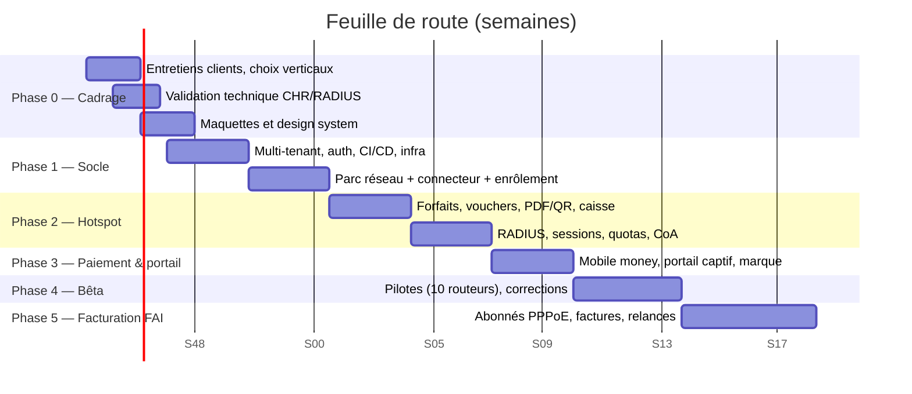

# 08 — Feuille de route, budget et mise sur le marché

> Statut : **plan de travail** · Dernière mise à jour : 2026-11-01
> Hypothèse d'équipe : 2 développeurs à temps plein, 1 designer à temps partiel (~20 %), le porteur
> du projet à la validation et au commercial. Durées en semaines ouvrées.

---

## 1. Vue d'ensemble

**MVP commercialisable (hotspot) : ~20 semaines** après le cadrage. La facturation FAI arrive ensuite,
portée par la demande réelle des pilotes.

---

## 2. Phase 0 — Cadrage et validation (3 semaines)

| # | Livrable | Critère de sortie |
|---|---|---|
| 0.1 | 10 entretiens (cybercafés, hôtels, petits FAI, installateurs) | 3 problèmes récurrents confirmés, 3 personnes prêtes à tester |
| 0.2 | Validation technique : CHR 7.11/7.18/6.49, RADIUS, tunnel derrière NAT | Journal de validation rempli, 0 blocage majeur |
| 0.3 | Décision de vertical et de périmètre MVP | Ce document signé, périmètre gelé |
| 0.4 | Maquettes : 10 écrans clés + portail captif | Parcours caissier validé par 2 utilisateurs réels |
| 0.5 | Choix d'hébergement, de domaine, d'agrégateur de paiement | Comptes créés, clés de test obtenues |
| 0.6 | Cadrage juridique (sous-traitance, CGU, mentions) | Documents en relecture |

> **Porte de décision n°1** : si moins de 3 clients pilotes s'engagent, revoir le vertical **avant**
> d'écrire du code produit.

---

## 3. Phase 1 — Socle (6 semaines)

| # | Contenu | Critère d'acceptation |
|---|---|---|
| 1.1 | Projet Django + DRF, settings par env, `core` (modèles abstraits, permissions, erreurs) | `make dev` en une commande |
| 1.2 | `accounts` + `tenants` : inscription, rôles, invitations, MFA, JWT | Tests d'isolation multi-tenant verts |
| 1.3 | Console React : layout, auth, routing, design system, TanStack Query | Login → dashboard en < 3 s |
| 1.4 | `network` : sites, devices, credentials chiffrés, statut | CRUD complet + audit |
| 1.5 | `mikrotik` : gateway, backends REST + binaire, `FakeBackend` de test | 90 % de couverture sur la couche |
| 1.6 | Enrôlement : script WireGuard + heartbeat + test de connexion | Un routeur réel s'enrôle en < 15 min |
| 1.7 | CI/CD, staging, supervision, sauvegardes | Déploiement + rollback testés |

**Démo de fin de phase** : ajouter un routeur depuis l'interface, le voir passer « en ligne », afficher
sa version et son CPU.

---

## 4. Phase 2 — Hotspot et RADIUS (6 semaines)

| # | Contenu | Critère d'acceptation |
|---|---|---|
| 2.1 | `catalog` : forfaits, profils hotspot, règles de quota | Création d'un forfait → profil créé sur le routeur |
| 2.2 | `vouchers` : génération, codes anti-ambiguïté, PDF/QR, import/export CSV | 500 coupons imprimables en < 30 s |
| 2.3 | `provisioning` : tâches idempotentes, réconciliation, états | Rejouer une tâche ne crée pas de doublon |
| 2.4 | `aaa` : FreeRADIUS + tables, auth, accounting, quotas, CoA | Session réelle avec coupure à l'expiration |
| 2.5 | Écran sessions actives (temps réel) + déconnexion | Déconnexion effective < 5 s |
| 2.6 | Caisse : vente, journal, reçu PDF | 3 clics, < 5 s, testé par un caissier |
| 2.7 | Mode dégradé (plateforme coupée) documenté et testé | Clients déjà connectés non coupés |

**Démo de fin de phase** : générer 100 vouchers, en utiliser un depuis un téléphone, voir la session
et la consommation, couper la session depuis la console.

---

## 5. Phase 3 — Paiement et portail (3 semaines)

| # | Contenu | Critère d'acceptation |
|---|---|---|
| 3.1 | `payments` : abstraction agrégateur, init, webhook signé, idempotence | Double webhook = un seul voucher |
| 3.2 | Portail captif personnalisable (logo, couleurs, textes) | Rendu < 1 s en 3G, mobile |
| 3.3 | Parcours d'achat : forfait → paiement → code + connexion | Taux de succès mesuré, erreurs explicites |
| 3.4 | Self-care abonné : statut, historique, renouvellement | Accessible sans compte |
| 3.5 | Réconciliation quotidienne (paiements vs factures) | Rapport automatique, écarts visibles |

---

## 6. Phase 4 — Bêta pilotée (4 semaines)

| # | Contenu | Critère de sortie |
|---|---|---|
| 4.1 | 10 routeurs pilotes chez 5 clients | 14 jours consécutifs sans incident bloquant |
| 4.2 | Support : base de connaissances, WhatsApp, runbooks | Temps de réponse < 4 h ouvrées |
| 4.3 | Corrections issues du terrain (priorité 1 uniquement) | Aucun bug critique ouvert |
| 4.4 | Tarification testée, contrats signés | 3 clients payants (même à tarif réduit) |
| 4.5 | Tableau de bord interne (usage, erreurs, MRR) | Revue hebdomadaire en place |

**Porte de décision n°2** : on continue seulement si (a) les pilotes utilisent le produit chaque
semaine, (b) au moins 2 acceptent de payer, (c) le support reste < 2 h/semaine/client.

---

## 7. Phase 5 — Facturation FAI (5 semaines, conditionnelle)

Abonnés PPPoE, abonnements, prorata, factures PDF, relances (WhatsApp/e-mail), suspension/reprise
automatique, paiements récurrents, gestion des adresses IP statiques, files d'attente par abonné.

Lancement uniquement si ≥ 3 pilotes hotspot demandent explicitement la facturation récurrente.

---

## 8. Backlog priorisé (extrait)

| Priorité | Élément | Estimation |
|---|---|---|
| P0 | Enrôlement routeur + tunnel + heartbeat | 5 j |
| P0 | Couche `MikroTikGateway` + backends + tests | 8 j |
| P0 | Multi-tenant + rôles + audit | 6 j |
| P0 | Vouchers (génération, PDF, provisioning) | 7 j |
| P0 | RADIUS auth + accounting + quotas | 8 j |
| P0 | Sessions actives + déconnexion | 3 j |
| P1 | Caisse + reçus | 3 j |
| P1 | Portail captif + paiement mobile money | 8 j |
| P1 | Sauvegarde config routeur + diff | 4 j |
| P1 | Alertes (routeur down, quota, CPU) | 4 j |
| P2 | Abonnés PPPoE + facturation | 15 j |
| P2 | Webhooks sortants + API tokens | 3 j |
| P2 | Marque blanche complète (domaine client) | 4 j |
| P3 | Application mobile technicien | 15 j |

---

## 9. Budget indicatif (FCFA)

| Poste | Montant | Commentaire |
|---|---|---|
| Développement (5 mois × 2 devs) | 4 000 000 – 5 000 000 | 400–500 k/mois/dev selon profil |
| Design (UI/UX, 3 mois à 20 %) | 600 000 | Maquettes, design system, portail |
| Infrastructure (5 mois) | 300 000 | VPS, stockage, e-mails, domaine |
| Juridique (CGU, sous-traitance, RGPD) | 400 000 | Cabinet local |
| Matériel de test (2 routeurs + 1 AP) | 250 000 | hAP ac², RB4011, AP |
| Marketing de lancement | 500 000 | Visuels, vidéos, déplacements, WhatsApp Business |
| **Total pour aller jusqu'à la bêta payante** | **≈ 6 000 000 – 7 000 000** | hors salaire du porteur |

Point mort approximatif : 15 clients Pro (25 000 FCFA) ≈ 375 000 FCFA/mois, soit ≈ coûts
d'infrastructure + support. Le poste dominant après le lancement est le **support**, pas la technique.

---

## 10. Mise sur le marché

| Étape | Action | Indicateur |
|---|---|---|
| Lancement | 5 clients pilotes équipés gratuitement 3 mois en échange de témoignages | 5 études de cas |
| Diffusion | Démonstrations sur site (cybercafés, hôtels), groupes WhatsApp/Facebook des techniciens | 40 démos/mois |
| Confiance | Vidéos courtes (enrôlement en 15 min, impression de vouchers) | 1 000 vues |
| Partenariats | Revendeurs MikroTik et installateurs (commission 20 % la 1ʳᵉ année) | 5 partenaires |
| Preuve | Page publique de statut, chiffres d'usage, témoignages | SLA affiché |
| Offre | Migration gratuite depuis Excel/WinBox, premier mois offert | 60 % des essais convertis |

Argumentaire à éviter : « le plus complet ». À privilégier : « votre caisse Wi-Fi ne perd plus
d'argent, et vous savez qui a payé — depuis votre téléphone ».

---

## 11. Risques de planning et parades

| Risque | Probabilité | Parade |
|---|---|---|
| Sous-estimation de l'intégration MikroTik | **Élevée** | Phase 0 technique obligatoire, 30 % de marge sur P1/P2 |
| Routeur client cassé par une commande | Moyenne | Réconciliation, sauvegarde avant modification, mode lecture seule par défaut |
| Agrégateur de paiement lent à valider le compte | Moyenne | Démarrer les démarches en Phase 0, prévoir un mode « encaissement manuel » |
| Périmètre qui gonfle | Élevée | Gel du périmètre MVP, tout ajout passe en « après bêta » |
| Un seul développeur disponible | Moyenne | Prioriser P0, retarder P2/P3, aucun raccourci sur les tests de la couche `mikrotik` |
| Clients sans tunnel accepté | Moyenne | Repli « pull » sur IP publique, documenté comme moins fiable |

---

## 12. Ce que « terminé » veut dire pour chaque fonctionnalité

Une fonctionnalité n'est livrée que si : tests automatisés · gestion d'erreur en français · entrée
d'audit · documentation utilisateur · observable (métrique ou log) · testée sur au moins un routeur
réel ou un CHR · pas de secret en clair. Sinon elle reste « en cours ».
